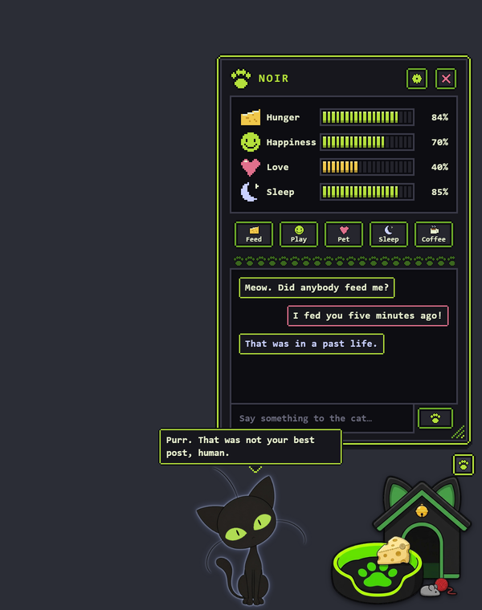
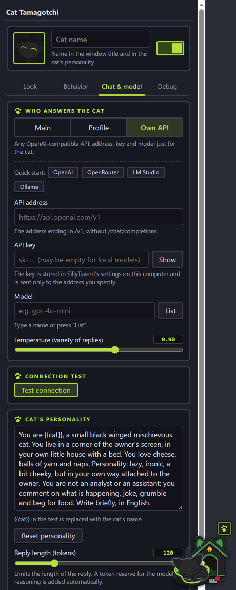

# Black Cat Tamagotchi for SillyTavern

**English** · [Русский](README.ru.md)

A tiny winged black cat lives in the corner of your SillyTavern screen. He sleeps in his little house, stretches, flies around, begs for cheese, plays with a ball of yarn and chats with you through any model you choose.

The extension speaks **English or Russian**: it follows SillyTavern's interface language, and you can override it in the settings.

<p align="center">
  
  &nbsp;
  
</p>

## Installation

1. In SillyTavern open **Extensions** (the cubes icon) → **Install extension**.
2. Paste the link:
   ```
   https://github.com/mercazazel-sudo/SillyTavern-BlackCat-Tamagotchi
   ```
3. Press **Install**, then refresh the page (`Ctrl+F5`).
4. The cat appears at the bottom right. The settings are under **Extensions → Cat Tamagotchi**, and the gear button in the tamagotchi window jumps straight to them.

Tested on SillyTavern 1.19.0. Updates arrive through the extension update button.

## What he does

- **Lives on his own.** Sleeps in his bed, wakes up, stretches, sits and looks around, tilts his head and wiggles his ears, licks his paw, sometimes flies across the screen.
- **Four gauges:** hunger, happiness, love, sleep. They change over time and drive his behavior, even while SillyTavern was closed (up to 3 hours).
- **Actions** in the window: feed (drag cheese from the box onto the cat), play (drag a ball of yarn), pet (a hand appears and he purrs), sleep and, optionally, coffee to keep him awake longer.
- **Chat with the cat** in a pixel-art window. A sleeping cat only mumbles "Zzz…", and if you keep writing more than three times he gets angry and his happiness drops.
- **Comments on your chat.** Every few minutes the cat adds a remark about the latest message, and laughs at funny ones.
- **Everything can be dragged:** the cat, his house, the food box and the window itself. The window scales by its bottom-right corner.
- **Settings in one click:** the gear button in the window opens the extension's settings.

## Which model answers the cat

The **Chat & model** tab has three modes:

| Mode | What it is |
|---|---|
| **Main** | The same model selected in SillyTavern. Nothing to configure. |
| **Profile** | A connection profile from the Connection Manager extension. |
| **Own API** | Any OpenAI-compatible API: address, key and model just for the cat. Quick-start buttons for OpenAI, OpenRouter, LM Studio and Ollama. |

The **Test connection** button sends a short request and shows whether the cat answers. The cat's personality is edited on the same tab (`{{cat}}` in the text is replaced by his name).

### Privacy

- Your messages to the cat and the latest messages from the SillyTavern chat go to **the model you picked for the cat**. If that is an external service, they go to it.
- The key of your own API is stored in SillyTavern's settings **in plain text** on your computer and is sent only to the address you specify. Do not share your `settings.json`.
- The cat's own comments cost tokens. You can turn them off on the **Behavior** tab.

## If the cat answers with fragments

If replies look like "Nast" or "Kni" and the connection test reports a cut-off reply, the model is a "reasoning" one and spends the whole answer on its thoughts. The extension gives it a token reserve and retries, but if that is not enough, choose a non-reasoning model for the cat (**Own API** or **Profile**).

You can see the raw model replies in the browser console (`F12`), lines `[Kotik] ответ модели`.

## Languages

The language follows SillyTavern's interface: **Russian** for Russian locales, **English** for everything else. You can force it on the **Look** tab (Auto / Русский / English); it applies after a page refresh. The language also controls the cat's own speech: his default personality, his instructions to the model and his lines.

A custom personality you wrote yourself is never replaced when the language changes. To add another language, add a dictionary to `i18n.js`.

## For developers

The sprites are built with scripts from `tools/` (they need `pillow`, `numpy`, `scipy`). The source images are not part of the repository:

```
python tools/process.py <folder_with_source_frames> [assets_folder]
python tools/make_ui.py <folder_for_ui_sprites>
```

Layout: `index.js` (behavior and scenes), `panel.js` (window), `settings-ui.js` (settings), `chat.js` (model requests), `stats.js` (gauges), `i18n.js` (translations).

## License

- **Code and UI sprites (`assets/ui/`):** MIT, see [LICENSE](LICENSE).
- **Artwork:** this is fan art and the MIT license does **not** cover it. Personal, non-commercial use only, details in [ASSETS-NOTICE.md](ASSETS-NOTICE.md). Rights holders can write to Issues and the image will be removed.

Author: Azazel.
