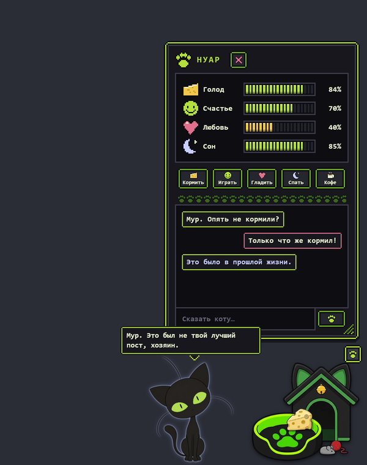
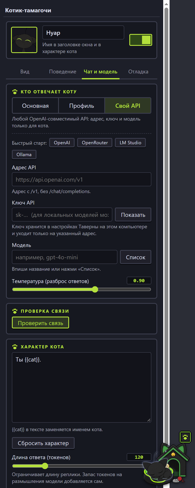

# Чёрный кот-тамагочи для SillyTavern

Мини-котик с крылышками живёт в углу экрана SillyTavern: спит в своём домике, потягивается, летает, просит сыр, играет с клубком и болтает с тобой. Для разговора можно выбрать любую модель.

<p align="center">
  
  &nbsp;
  
</p>

## Установка

1. В SillyTavern открой **Расширения** (иконка с кубиками) → **Установить расширение**.
2. Вставь ссылку:
   ```
   https://github.com/mercazazel-sudo/SillyTavern-BlackCat-Tamagotchi
   ```
3. Нажми **Install** и обнови страницу (`Ctrl+F5`).
4. Котик появится справа внизу. Настройки лежат в **Расширениях → Котик-тамагочи**.

Протестировано на SillyTavern 1.19.0. Обновления подтягиваются кнопкой обновления расширений.

## Что умеет

- **Живёт сам.** Спит в лежанке, просыпается, потягивается, сидит и смотрит, наклоняет голову и шевелит ушками, лижет лапу, иногда летает по экрану.
- **Четыре шкалы:** голод, счастье, любовь, сон. Они меняются со временем и влияют на поведение, даже пока Таверна была закрыта (не дольше 3 часов).
- **Действия** в окне: кормить (тащишь сыр из коробки на котика), играть (тащишь клубок), гладить (появляется рука и котик мурлыкает), спать и, по желанию, кофе, чтобы он дольше бодрствовал.
- **Чат с котиком** в пиксельном окне. Спящий котик отмахивается «Zzz…», а если писать ему больше трёх раз, злится, и счастье падает.
- **Комментарии к твоему чату.** Раз в несколько минут котик сам вставляет реплику про последнее сообщение, а на смешное смеётся.
- **Всё двигается мышкой:** котик, домик, коробка с едой и само окно. Окно масштабируется за правый нижний угол.

## Какая модель отвечает коту

На вкладке **Чат и модель** три режима:

| Режим | Что это |
|---|---|
| **Основная** | Та же модель, что выбрана в Таверне. Ничего вводить не нужно. |
| **Профиль** | Профиль подключения из расширения Connection Manager. |
| **Свой API** | Любой OpenAI-совместимый API: адрес, ключ, модель только для кота. Есть быстрый старт для OpenAI, OpenRouter, LM Studio и Ollama. |

Кнопка **Проверить связь** шлёт короткий запрос и показывает, отвечает ли кот. Характер кота редактируется там же (в тексте `{{cat}}` подставляется имя).

### Важно про приватность

- Твои сообщения коту и последние сообщения из чата Таверны уходят **той модели, которую ты выбрал для кота**. Если это внешний сервис, они уходят ему.
- Ключ собственного API хранится в настройках SillyTavern **открытым текстом** на твоём компьютере и отправляется только на указанный адрес. Не отправляй другим файл `settings.json`.
- Самостоятельные комментарии тратят токены. Их можно выключить на вкладке **Поведение**.

## Если кот отвечает обрубками

Если ответы похожи на «Настро» или «Кни», а на проверке связи вылезает ошибка про обрубок, значит, модель с «рассуждениями» тратит весь ответ на мысли. Расширение само даёт запас токенов и повторяет запрос, но если не помогает, выбери для кота модель без рассуждений (режим **Свой API** или **Профиль**).

Сырые ответы модели можно посмотреть в консоли браузера (`F12`), строки `[Kotik] ответ модели`.

## Для разработчиков

Спрайты собираются скриптами из `tools/` (нужны `pillow`, `numpy`, `scipy`). Исходные картинки в репозиторий не входят:

```
python tools/process.py <папка_с_исходными_кадрами> [папка_assets]
python tools/make_ui.py <папка_для_интерфейса>
```

Структура: `index.js` (поведение и сцены), `panel.js` (окно), `settings-ui.js` (настройки), `chat.js` (запросы к модели), `stats.js` (шкалы).

## Лицензия

- **Код:** MIT, см. [LICENSE](LICENSE).
- **Картинки:** это фанарт, и MIT на них **не распространяется**. Только личное некоммерческое использование, подробности в [ASSETS-NOTICE.md](ASSETS-NOTICE.md). Правообладатели могут написать в Issues, и изображение уберут.

Автор: Azazel.
